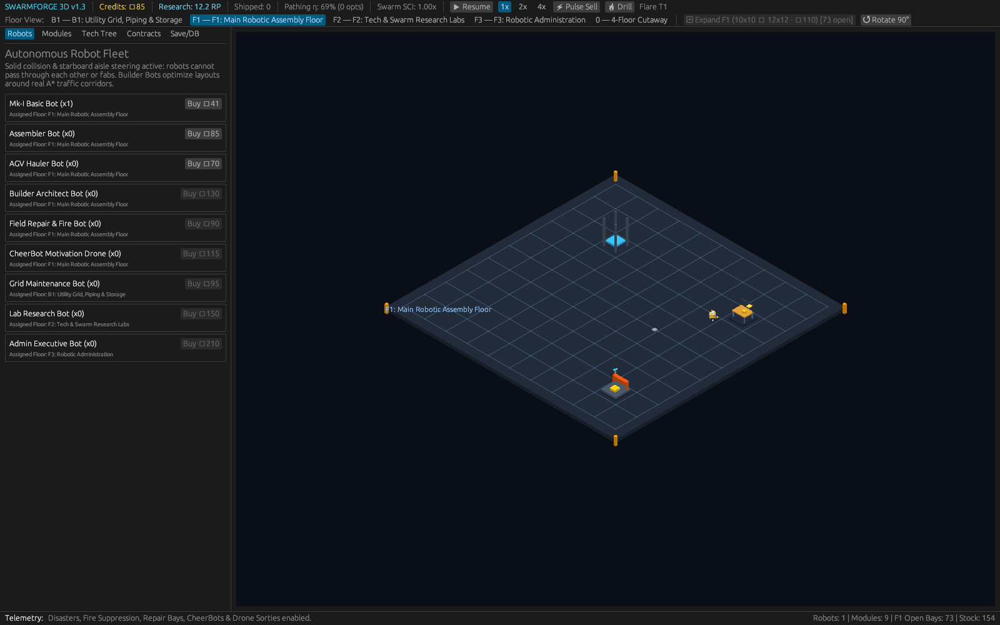

# SwarmForge (`swarmforge` v1.3.0)



Native safe-Rust (`#![forbid(unsafe_code)]`) 3D isometric automated robotic factory and swarm intelligence simulation featuring **bespoke articulated 3D CAD sub-assemblies**, **exact octile-heuristic A* tri-grid collision-free routing**, **continuous-time deterministic Poisson industrial hazards**, **aerial drone contact shadows & aura overlays**, **multi-floor cutaway rendering**, and **SQLite WAL + JSON persistence**.

- **User Guide**: [`docs/USER_GUIDE.md`](docs/USER_GUIDE.md)
- **Scientific Methods & Equations**: [`docs/SCIENTIFIC_METHODS.md`](docs/SCIENTIFIC_METHODS.md)
- **License**: GNU General Public License v3.0 or later ([`LICENSE`](LICENSE))

## Scientific & Architectural Highlights

- **Exact Admissible Octile A* Navigation & Solid Collision (`src/navigation.rs`, `src/builder_ai.rs`)**:
  - Evaluates 8-connected factory corridors (`CELL_PITCH = 2.4u`, tri-grid `NAV_STEP = 0.8u`) with exact admissible octile heuristic `h(n) = 10·max(|Δx|, |Δz|) + 4·min(|Δx|, |Δz|)` matching cardinal cost `10` and diagonal cost `14`.
  - Enforces minimum 2-bay Chebyshev clearance (`MIN_MODULE_CHEBYSHEV = 3`), starboard aisle steering, orthogonal unstick deflection, and real-time corridor congestion heat tracking (`congestion_map`).
- **Multi-Unit Throughput & Zero-Downtime Hot-Swaps (`src/assembly.rs`)**:
  - Accumulates station progress using a draining `while work_progress >= 1.0` loop so `2x`/`4x` multi-unit simulation ticks never drop throughput.
  - Honors unlocked `robo_lights_out` (`[R8] Lights-Out Megafactory`), allowing stations with `being_relocated = true` to continue pulling feedstock, assembling, and dispatching parts mid-relocation.
- **Deterministic Seeded Poisson Disasters & Escalation (`src/disasters.rs`)**:
  - Drives stochastic hazard spawns via a deterministic SplitMix64 PRNG stored in `GameState::rng_seed` and continuous-time Poisson hazard probability `p = 1 - exp(-λ · Δt)`.
  - Unsuppressed active fires escalate monotonically toward severity `1.0` (`+0.028·Δt`) until countered by `FireSuppressionTower` cryo-foam (`SUPPRESSION_RADIUS = 10.5u`), `RepairBot` responders, or manual emergency breaker override.
- **3D/2D Isometric & WGSL Rendering Fidelity (`src/iso_renderer.rs`, `shaders/iso_factory.wgsl`)**:
  - Uses inverse-scale normal transform `normalize(v.normal / max(|scale|, 1e-4))` with Blinn-Phong specular and Fresnel rim highlights across both WGSL and CPU isometric painters.
  - Renders ground contact shadows beneath aerial `MotivationDrone` (`CHEER_AURA_RADIUS = 8.5u`) and `DeliveryDock` sortie drones, a depth-sorted 3D compass triad (`X`/`Y`/`Z`), and toggleable floor overlays (`Cryo`, `Cheer`, `Heat`).

## Desktop Controls & Keyboard Shortcuts

All single-key shortcuts automatically yield when typing in any text field (`!ctx.wants_keyboard_input()`).

| Input | Action |
|---|---|
| `Space` | Pause / Resume simulation |
| `[` / `]` | Cycle simulation speed (`1x` <-> `2x` <-> `4x`) |
| `W` / `A` / `S` / `D` | Pan isometric viewport |
| `Q` / `E` | Rotate camera yaw `-90°` / `+90°` |
| `R` | Reset `IsoCamera` to default yaw, pitch, zoom, pan, and floor view |
| `1` – `4` | Switch single floor (`1`: `B1`, `2`: `F1`, `3`: `F2`, `4`: `F3`) |
| `0` | Switch to `4-Floor Cutaway` translucent X-Ray view |
| `Primary-Drag` | Orbit camera yaw and pitch |
| `Secondary-Drag` | Pan viewport freely |
| `Scroll Wheel` | Zoom camera (`6.0x..95.0x`) |
| `Shift + Click` | Continuous bay placement while `Click Floor` mode is armed |
| `Esc` | Dismiss About -> Cancel placement mode -> Deselect entity |
| `F1` | Toggle About & Shortcuts Cheat Sheet modal |

## Quick Start & CLI Flags

```bash
# Run full unit & integration test suite
cargo test --all-targets

# Launch native desktop workstation
cargo run --release

# Run headless deterministic benchmark ticks and export JSON snapshot
cargo run --release -- --headless-ticks 600 --export-json swarmforge_save.json

# Import a saved JSON factory and run 300 ticks
cargo run --release -- --import-json swarmforge_save.json --headless-ticks 300

# Render 1600x1000 offscreen RGBA PNG screenshot via wgpu (view 1=F1, 2=Cutaway, 3=Disasters/Auras)
cargo run --release -- --headless-screenshot validation/view1.png --screenshot-view 1
```

| CLI Flag | Default | Purpose |
|---|---|---|
| `--db-path <PATH>` | `swarmforge_saves.db` | SQLite WAL save-slot database path |
| `--import-json <PATH>` | — | Load initial `GameState` from JSON snapshot |
| `--headless-ticks <N>` | — | Step simulation `N` ticks (`dt = 0.1 s`) headlessly and print summary |
| `--export-json <PATH>` | — | Export final state JSON after `--headless-ticks` |
| `--headless-screenshot <PATH>` | — | Render `1600x1000` offscreen RGBA PNG without opening a window |
| `--screenshot-view <1\|2\|3>` | `1` | Select preset camera/scene for `--headless-screenshot` |

## Validation Suite & Empirical Metrics

Run `$env:CARGO_BUILD_JOBS='4'; cargo test --all-targets` (`25` unit tests in `src/lib.rs`, `2` integration tests in `tests/integration_r2.rs`):

| Test / Module | Verified Scientific / System Metric |
|---|---|
| `navigation::tests::astar_corridor_cost_uses_exact_admissible_octile_metric` | Open-floor `(0,0) -> (4,4)` yields exact octile cost `5.6` and `5`-cell diagonal path |
| `assembly::tests::lights_out_relocation_produces_and_while_loop_emits_multi_unit_ticks` | Relocating module skips production when locked, advances with `robo_lights_out`, and `rate * dt = 2.5` emits `2` units (`0.5` remainder) |
| `disasters::tests::deterministic_seeded_poisson_disasters_and_unsuppressed_fire_escalation` | Identical `rng_seed` replays match bit-for-bit under `1 - exp(-λ·Δt)`; unsuppressed fire escalates from `0.50` strictly toward `1.0` |
| `iso_renderer::tests::renders_drone_shadows_aura_rings_congestion_tiles_and_compass_triad` | Ground contact shadows, `10.5u`/`8.5u` aura rings, congestion heat tiles, and `X/Y/Z` triad render cleanly |
| `app::tests::camera_pan_reset_speed_cycle_and_shift_continuous_placement` | `W/A/S/D` pan, `[/]` speed cycle, `R` camera reset, `Shift+Click` continuous placement, and Shortcut tab verified |
| `tests/integration_r2.rs` | SQLite WAL save/load/delete roundtrip + zero tofu glyphs + copyright/About UI compliance |

## Citation & CRV Science Apps Hub

- **CRV Science Apps Hub**: <https://crvscience.com/apps>
- **Companion Preprint (`APP-PREPRINT-18`)**: [SwarmForge: 3D Isometric Automated Factory and Swarm Robotics Simulation Game](https://crvscience.com/apps/preprints/swarmforge-isometric-swarm-factory-game)
- **Zenodo DOI**: [10.5281/zenodo.24244093](https://doi.org/10.5281/zenodo.24244093)
- **Machine-Readable Metadata**: [`CITATION.cff`](CITATION.cff)
